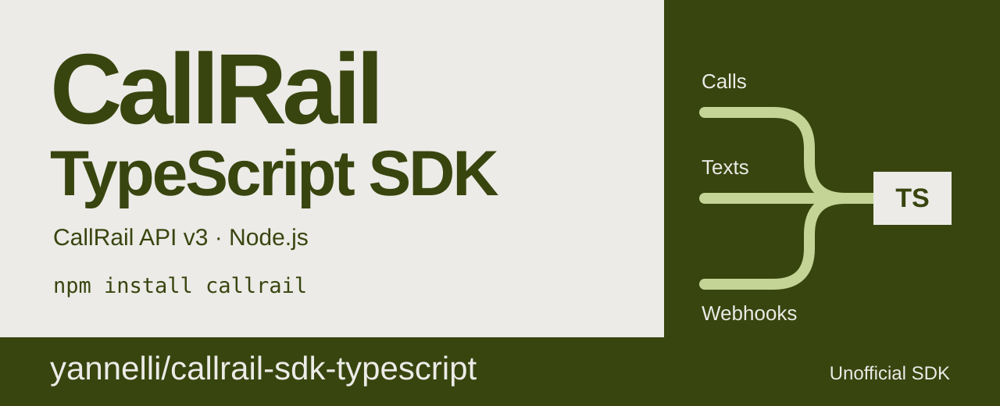

# CallRail SDK for TypeScript and Node.js



[](https://github.com/yannelli/callrail-sdk-typescript/actions/workflows/ci.yml)
[](LICENSE)
[](https://nodejs.org/)

`callrail` is a TypeScript SDK for the [CallRail API v3](https://apidocs.callrail.com/). Use it to read and change calls, text messages, form submissions, leads, companies, tracking numbers, and other account resources. It also checks and decodes CallRail webhooks. The package has no runtime dependencies.

## Features

- Each id has its own type. The compiler rejects a company id where a call id belongs.
- A failed request throws a `CallRailError`. Its `problem` property is a typed union that you can `switch` on.
- Lists support automatic pagination. Loop with `for await`, and the client gets each page when you need it.
- The client retries a `GET` after a network error, a timeout, or a 500, 502, 503, or 504 response. Writes never retry, which prevents duplicate text sends from retries.
- `callrail/webhooks` checks webhook signatures before it returns a typed event.
- `callrail/testing` gives your tests a scripted `fetch` that records each request.

## Install

```bash
npm install github:yannelli/callrail-sdk-typescript
```

The package is not on the npm registry. npm clones the repository and builds it during install. The package needs Node.js 20 or later. It is published as ES modules. [Installation](docs/installation.md) tells you how to configure TypeScript and how to load the package from CommonJS.

## Quickstart

```ts
import { CallRail, CallRailError } from "callrail";

const apiKey = process.env.CALLRAIL_API_KEY;
if (!apiKey) throw new Error("Set CALLRAIL_API_KEY to an API key from your CallRail settings.");

const callrail = new CallRail({ apiKey });
const account = callrail.account("ACC8154748ae6bd4e278a7cddd38a662f4f");

try {
  for await (const call of account.calls.list({ dateRange: "last_7_days" })) {
    console.log(call.startTime, call.customerName, call.duration);
  }
} catch (error) {
  if (error instanceof CallRailError && error.problem.kind === "unauthorized") {
    console.error("CallRail rejected the API key.");
  } else {
    throw error;
  }
}
```

`callrail.account(id)` sends no request. It returns a client for one account, with each resource of that account, such as `account.calls` and `account.trackers`.

## Documentation

Start here:

- [Installation](docs/installation.md)
- [Configuration](docs/configuration.md)
- [Accounts and ids](docs/accounts.md)
- [Pagination](docs/pagination.md)
- [Filtering and fields](docs/filtering-and-fields.md)
- [Errors and rate limits](docs/errors-and-rate-limits.md)

Resources:

- [Calls](docs/calls.md)
- [Text messages](docs/text-messages.md)
- [SMS threads](docs/sms-threads.md)
- [Form submissions](docs/form-submissions.md)
- [Leads](docs/leads.md)
- [Companies](docs/companies.md)
- [Trackers](docs/trackers.md)
- [Message flows](docs/message-flows.md)
- [Outbound caller ids](docs/caller-ids.md)
- [Tags](docs/tags.md)
- [Users](docs/users.md)
- [Notifications](docs/notifications.md)
- [Summary emails](docs/summary-emails.md)
- [Integrations](docs/integrations.md)
- [Integration filters](docs/integration-filters.md)

Webhooks and tests:

- [Webhooks](docs/webhooks.md)
- [Testing](docs/testing.md)

## FAQ

### Is this an official CallRail SDK?

No. This is an independent open source package. CallRail did not make it and does not support it. For the API itself, read the [CallRail API reference](https://apidocs.callrail.com/).

### Which version of the CallRail API does it use?

It uses the CallRail API v3. It has a method for each of 71 HTTP operations, across the 16 resources in the [documentation](#documentation). Tests check the HTTP method and path of each operation.

### Which runtimes does it support?

It supports Node.js 20 or later, on a server. The package imports `node:http` and `node:crypto`, so it does not run in a browser. Keep your API key on the server.

### Can I use it from CommonJS?

Yes. The package is ES modules only, so load it with `await import("callrail")` in a CommonJS file. [Installation](docs/installation.md#before-you-install) gives the details.

### How do I get a CallRail API key?

Create a key in your CallRail settings. The key belongs to a user and sees the same data that the user sees in the CallRail app. Put the key in an environment variable, such as `CALLRAIL_API_KEY`. Do not put the key in your code.

### Does the client retry failed requests?

It retries a `GET` after a network error, a timeout, or a 500, 502, 503, or 504 response. The default is two more tries. It never retries a `POST`, a `PUT`, a `DELETE`, or a 429 response. [Configuration](docs/configuration.md#set-timeouts-and-retries) tells you how to change the timeout and the number of retries.

### How does it handle CallRail rate limits?

The client has no rate limiter. When CallRail sends a 429 response, the client throws a `CallRailError` whose `problem.kind` is `rate_limited`. `problem.bucket` names the limit, which is `general`, `sms_send`, or `outbound_call`. [Errors and rate limits](docs/errors-and-rate-limits.md#stay-within-the-rate-limits) gives the limits.

### How do I verify a CallRail webhook signature?

Use `readWebhook` from `callrail/webhooks`. It checks the `Signature` header against the raw request body with your company signing key. Then it decodes the body. If the check fails, it throws a `WebhookError`. [Webhooks](docs/webhooks.md#receive-a-webhook) has a full Express example.

### How do I test code that uses the client?

Give the client the `fakeFetch` function from `callrail/testing`. It sends the replies that you script, in sequence, and it records each request. Your tests send no requests to CallRail. [Testing](docs/testing.md) has examples.

## Contributing

Bug reports, feature requests, and pull requests are welcome. Read [CONTRIBUTING.md](CONTRIBUTING.md) to set up the project and run the checks. To report a security vulnerability, read [SECURITY.md](SECURITY.md).

[Repository artwork](docs/artwork.md) covers image generation and the GitHub social preview upload.

## Author

Created by [Ryan Yannelli](https://ryanyannelli.com), a Senior Engineer.

## License

`callrail` is available under the [MIT License](LICENSE). CallRail is a trademark of CallRail, Inc. This project is not affiliated with CallRail, Inc.
